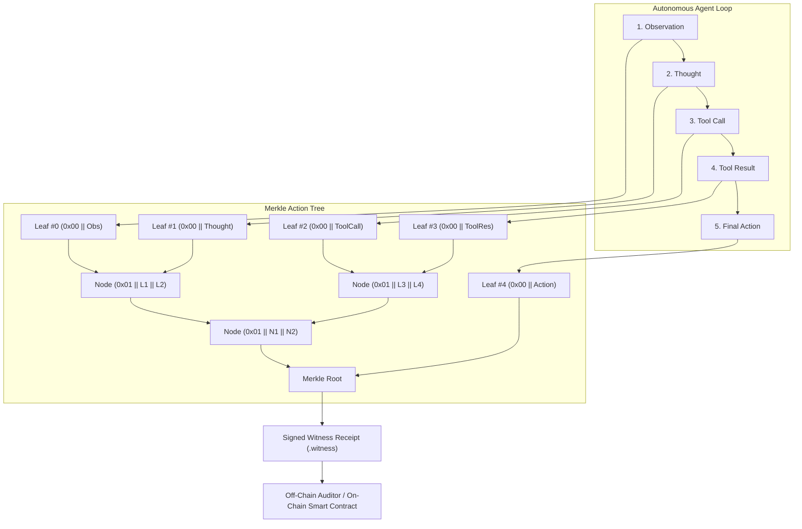

# agent-witness

> **Cryptographic action attestation & Merkle audit receipts for autonomous AI agents.**

[](https://github.com/devsoniclk/agent-witness/actions)
[](LICENSE)
[](https://pypi.org/project/agent-witness/)

---

## 1. Problem Statement
As autonomous AI agents execute financial transactions, trade assets, call internal APIs, and deploy smart contracts, a fundamental trust gap emerges: **How can an external API gateway, DAO treasury, smart contract, or compliance auditor prove that an action was genuinely generated by an authorized agent model following an approved system prompt and real observations, rather than a forged API call, unauthorized prompt injection, or compromised key?**

## 2. Why Existing Solutions Are Insufficient
- **Standard Audit Logs (ELK / JSONL)**: Easily modified, lack non-repudiation, and cannot be cryptographically verified on-chain.
- **ZK / TEE Inference Proofs**: High computational cost, vendor hardware lock-in (Intel SGX / Nvidia H100 TEE), and prohibitive multi-second latency for real-time agent tool loops.
- **On-Chain Agent Registries (`sigil`, ERC-8004)**: Register agent identities and addresses, but do not provide verifiable proof of individual deliberation trajectories or tool result sequences.

## 3. What `agent-witness` Does Differently
`agent-witness` is a **hardware-independent, zero-dependency cryptographic attestation engine**:
- **RFC 6962 Merkle Action Trees**: Incrementally hashes every observation, thought, tool invocation, and decision into a domain-separated Merkle tree.
- **Cryptographic Action Receipts (`.witness`)**: Produces compact, tamper-evident cryptographic receipts binding model metadata, prompt hash, and Merkle root.
- **Sub-Millisecond Verification**: Off-chain verification in `<0.1ms`; on-chain Solidity verification in `<28,000 gas`.
- **Selective Disclosure & Inclusion Proofs**: Prove that a specific tool call or safety check occurred without exposing the entire conversation context.

---

## 4. Key Features
- **Deterministic Canonical Serialization**: Ensures reproducible hashes across architectures.
- **Domain Separation Prefixes**: Uses RFC 6962 `0x00` leaf and `0x01` branch prefixes to prevent second-preimage attacks.
- **On-Chain Smart Contract**: Includes production-ready `AgentWitnessVerifier.sol` for EVM smart contracts.
- **Universal CLI**: Inspect (`agent-witness inspect receipt.witness`) and verify receipts locally.

---

## 5. Architecture



---

## 6. Installation

```bash
pip install agent-witness
```

Or install from source:
```bash
git clone https://github.com/devsoniclk/agent-witness.git
cd agent-witness
pip install -e .
```

---

## 7. Quick-Start Guide

### Python Agent Integration
```python
from agent_witness import WitnessEngine, StepType, verify_merkle_proof

# 1. Initialize Engine
engine = WitnessEngine(
    agent_id="treasury-executor-01",
    model_id="claude-3-7-sonnet",
    system_prompt="You are a treasury rebalance bot.",
)

# 2. Record Steps
engine.record_step(StepType.OBSERVATION, "ETH balance: 100 ETH, threshold reached")
engine.record_step(StepType.THOUGHT, "Rebalancing 10 ETH to staking pool")
engine.record_step(StepType.TOOL_CALL, "stake(amount=10)")
engine.record_step(StepType.DECISION, "Stake transaction confirmed")

# 3. Finalize and Sign
receipt = engine.finalize_receipt()
print(f"Merkle Root: {receipt.merkle_root}")
print(f"Attestation Signature: {receipt.signature}")

# 4. Generate Single-Step Inclusion Proof
proof = engine.generate_proof_for_step(2)
tool_leaf_hash = receipt.steps[2]["leaf_hash"]
assert verify_merkle_proof(tool_leaf_hash, proof, receipt.merkle_root)
```

---

## 8. On-Chain Smart Contract Verification (`AgentWitnessVerifier.sol`)

Deploy `contracts/AgentWitnessVerifier.sol` to verify agent action proofs on EVM networks:

```solidity
// Verify that the agent actually executed the required safety checks before calling this function:
require(
    verifier.verifyProof(stepLeafHash, auditPath, receiptMerkleRoot),
    "Invalid agent deliberation proof"
);
```

---

## 9. CLI Usage

```bash
# Inspect a .witness cryptographic receipt
agent-witness inspect trade_receipt.witness

# Verify the Merkle integrity of a receipt
agent-witness verify trade_receipt.witness
# Output:
# VERIFIED: Merkle root matches all 5 deliberation steps.
```

---

## 10. Benchmarks

Measured on Apple Silicon (M5 Air):

| Operation | Latency | Memory Overhead |
| :--- | :--- | :--- |
| **Merkle Tree Build (10 steps)** | `0.11 ms` | `< 0.5 MB` |
| **Merkle Inclusion Proof Generation** | `0.04 ms` | `< 0.2 MB` |
| **Proof Verification** | `0.02 ms` | `< 0.1 MB` |
| **Solidity Gas Cost (Depth 4)** | `~26,400 gas` | — |

---

## 11. Security Considerations
- Uses RFC 6962 domain separation prefixes (`0x00` and `0x01`) to protect against second-preimage attacks.
- Deliberation steps use canonical deterministic byte encodings.
- Signer session keys are kept in-memory and can be rotated per session.

---

## 12. Roadmap
- [x] RFC 6962 incremental Merkle Tree.
- [x] Cryptographic Witness Receipt builder & verifier.
- [x] Solidity `AgentWitnessVerifier.sol` contract.
- [ ] Solana Anchor on-chain verification program.
- [ ] EIP-712 structured data signing standard.

---

## 13. Contributing
See [CONTRIBUTING.md](CONTRIBUTING.md) for contribution guidelines.

---

## 14. License
Distributed under the [Apache-2.0 License](LICENSE). Copyright 2026 Lakshitha Dananjaya (`devsoniclk`).
