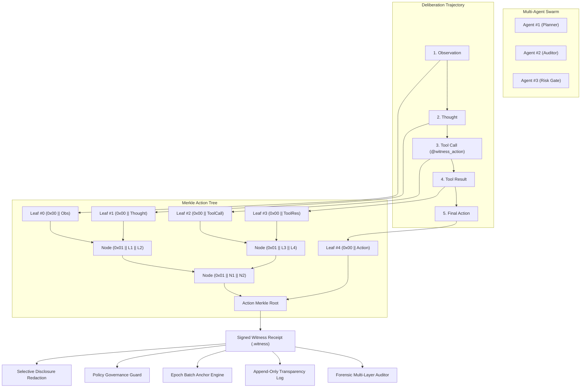

# agent-witness

> **Cryptographic action attestation, selective disclosure redaction, enterprise policy governance, transparency logs & Merkle audit receipts for autonomous AI agents.**

[](https://github.com/devsoniclk/agent-witness/actions)
[](LICENSE)
[](https://pypi.org/project/agent-witness/)
[](https://github.com/devsoniclk/agent-witness/releases/tag/v0.10.0)

---

## 1. Problem Statement
As autonomous AI agents execute financial transactions, trade assets, call internal APIs, and deploy smart contracts, a fundamental trust gap emerges: **How can an external API gateway, DAO treasury, smart contract, or compliance auditor prove that an action was genuinely generated by an authorized agent model following an approved system prompt and real observations, rather than a forged API call, unauthorized prompt injection, or compromised key?**

## 2. Why Existing Solutions Are Insufficient
- **Standard Audit Logs (ELK / JSONL)**: Easily modified retroactively, lack non-repudiation, and cannot be cryptographically verified on-chain.
- **ZK / TEE Inference Proofs**: High computational cost, vendor hardware lock-in (Intel SGX / Nvidia H100 TEE), and prohibitive multi-second latency for real-time agent tool loops.
- **On-Chain Agent Registries (`sigil`, ERC-8004)**: Register agent identities and addresses, but do not provide verifiable proof of individual deliberation trajectories or tool result sequences.

## 3. What `agent-witness` Does Differently
`agent-witness` is an enterprise-grade, **hardware-independent, zero-dependency cryptographic attestation engine**:
- **RFC 6962 Merkle Action Trees**: Incrementally hashes every observation, thought, tool invocation, and decision into a domain-separated Merkle tree.
- **Cryptographic Action Receipts (`.witness`)**: Produces compact, tamper-evident cryptographic receipts binding model metadata, prompt hash, and Merkle root.
- **Selective Disclosure Redaction Engine**: Conceal confidential thoughts, sensitive tool payloads, PII, or API keys while strictly preserving 100% cryptographic Merkle root verifiability.
- **Enterprise Policy Governance Engine**: Deterministically audits agent trajectories against customizable invariant policies (MaxSteps, DisallowedTools, RequiredHumanApproval, ExecutionDuration, StepRepetition).
- **Epoch Batch Merkle Anchoring**: Aggregates hundreds of agent deliberation receipts into an Epoch Merkle Root, producing turnkey EVM calldata and Solana SPL Memo payloads for ultra low-cost on-chain settlement.
- **Selective Disclosure Proof Bundles**: Prove that a critical safety check or specific trade tool call occurred without revealing confidential prompts or private reasoning tokens.
- **Tamper-Evident Chronological Transparency Logs**: Append-only cryptographic ledger maintaining Signed Tree Heads (STH), producing verifiable audit inclusion proofs and historical consistency proofs.
- **Multi-Agent Threshold Consensus**: Cryptographic quorum attestation where multiple collaborative agents (e.g. planner, auditor, risk gate) sign off on shared action trajectories.
- **Multi-Chain Anchor Dispatcher**: Generates cross-chain anchor transaction payloads across Solana Anchor state programs (with PDA derivation) and EVM L1/L2 contracts with threshold quorum attestation.
- **Streaming Action Session & Continuous Deliberation Provenance**: Incremental rolling Merkle frontier accumulator with O(1) amortized leaf addition and causal thought-to-action grounding audits.
- **Automated Compliance & Anomaly Detector**: Real-time evaluation of action streams for velocity bursts, cumulative value-at-risk caps, authority drift, and temporal clock skews.
- **zkVM Deliberation Receipt Engine**: Native RISC Zero Image ID and Succinct SP1 verification key binding, committing public execution journals with cryptographic seals.
- **Cross-Chain Attestation Dispatcher**: Out-of-the-box LayerZero v2 OApp messaging and Chainlink CCIP `Client.EVM2AnyMessage` encoding with dynamic cross-chain fee estimation.
- **Recursive Super-Merkle Rollup Batching**: 2nd-order Merkle aggregation compressing multi-agent swarm trajectories into a single super-root, slashing on-chain calldata costs by >90%.
- **Byzantine Fault Tolerant (BFT) Consensus Engine**: Tendermint/PBFT-style 2-phase BFT commit protocol (`PREVOTE` + `PRECOMMIT`) with cryptographic voting thresholds ($Q = \lfloor 2W/3 \rfloor + 1$), equivocation detection, conflicting pre-commit defense, automatic validator slashing, and multi-signature certificate issuance.
- **Model Context Protocol (MCP) Server**: Standard JSON-RPC 2.0 stdio server providing 35 cryptographic tools to autonomous coding agents (Claude Code, OpenBot, Cursor, Cline).
- **Unified Cross-Portfolio Lifecycle Bridge (`AgentLifecycleBridge`)**: Bridges `rollback` transactional sandboxing, `solana-tx-lens` pre-flight simulation, and `agent-witness` zkVM/cross-chain attestations into an atomic, verifiable execution pipeline with automatic rollback upon compute unit or policy violation.
- **W3C Verifiable Agent Credentials**: Standardized Decentralized Identifier (`did:key`) identity binding, issuing cryptographic credentials with delegated capability boundaries, model whitelists, financial caps, and sponsor attestations.
- **Zero-Knowledge Action Attestation**: Succinct zero-knowledge proof generation proving step bounds, latency limits, model membership, and tool whitelists via Fiat-Shamir heuristics without leaking raw thoughts, prompts, or outputs.
- **Cryptographic Revocation Registry & Operator Kill-Switch**: Tamper-evident Merkle revocation registry and emergency pause gate to immediately invalidate compromised agent keys and quarantine rogue trajectories.
- **Forensic Multi-Layer Trajectory Auditor**: End-to-end verification engine checking step sequence continuity, timestamp monotonicity, canonical leaf hashes, Merkle root validity, signatures, log inclusion, policy compliance, and consensus quorums.
- **Interactive Dark-Mode HTML Audit Dossier**: Offline, dependency-free visual reports featuring responsive SVG Merkle tree diagrams, redacted step shields, expandable step timelines, and verification badges.
- **Universal Tool Middleware**: Intercept and attest synchronous and asynchronous agent functions with `@witness_action`.
- **EIP-712 Structured Data Standards**: Zero-dependency pure Python Keccak-256 and EIP-712 typed struct hashing for instant EVM smart contract verification (`ecrecover`).
- **Cross-Chain Verifiers**: Production-ready on-chain verification programs for both **Ethereum (Solidity)** and **Solana (Anchor)**.
- **Sub-Millisecond Verification**: Off-chain verification in `<0.1ms`; on-chain EVM verification in `<28,000 gas`.

---

## 4. Architecture



---

## 5. Quickstart

### Installation
```bash
pip install agent-witness
```

### Basic Attestation
```python
from agent_witness import WitnessEngine, StepType

# Initialize witness engine for an autonomous agent
engine = WitnessEngine(
    agent_id="agent-trader-01",
    model_id="anthropic/claude-3-5-sonnet",
    system_prompt="You are a risk-managed algorithmic trading agent.",
)

# Record deliberation trajectory steps
engine.record_step(StepType.OBSERVATION, "SOL/USDC price dropped to 142.10 on Raydium.")
engine.record_step(StepType.THOUGHT, "Spread is 0.42% vs Orca. Favorable arb opportunity detected.")
engine.record_step(StepType.TOOL_CALL, "orca.swap(SOL -> USDC, amount=10.0)")
engine.record_step(StepType.TOOL_RESULT, "Swap executed: received 1,421.00 USDC, fee 0.05%")
engine.record_step(StepType.DECISION, "Order complete. Profit: +5.92 USDC.")

# Finalize immutable cryptographic receipt
receipt = engine.finalize_receipt()
print(f"Attested Action Merkle Root: {receipt.merkle_root}")
print(f"Ed25519 Signature: {receipt.signature[:32]}...")
```

### Selective Disclosure Redaction (v0.5.0)
```python
from agent_witness import RedactionEngine

# Redact confidential thoughts or private client data (steps #1 and #2)
redacted_receipt = RedactionEngine.redact_receipt(
    receipt=receipt,
    redact_steps=[1, 2],
    redact_reason="Confidential Trading Alpha",
)

# Verifies 100% against the original signed Merkle root!
is_valid, msg = RedactionEngine.verify_selective_disclosure(redacted_receipt)
print(f"Cryptographically Valid: {is_valid}")
```

### Policy Governance Guard (v0.5.0)
```python
from agent_witness import PolicyGuard, MaxStepsRule, DisallowedToolsRule, RequiredApprovalRule

guard = PolicyGuard(rules=[
    MaxStepsRule(max_steps=50),
    DisallowedToolsRule(blacklisted_tools=["rm", "eval", "sudo"]),
    RequiredApprovalRule(sensitive_tools=["wire_payment", "execute_trade"]),
])

report = guard.evaluate(receipt)
print(f"Policy Compliant: {report.is_compliant} ({report.verdict})")
```

### Epoch Batch On-Chain Anchoring (v0.5.0)
```python
from agent_witness import BatchAnchorEngine

engine = BatchAnchorEngine(epoch_id="epoch_2026_11_16")
engine.add_receipt(receipt_1)
engine.add_receipt(receipt_2)
batch_receipt, proofs = engine.build_batch()

print("EVM Calldata:", batch_receipt.to_evm_calldata())
print("Solana Memo:", batch_receipt.to_solana_memo())
```

---

## 6. CLI Usage

```bash
# 1. Inspect a receipt JSON
agent-witness inspect trade_receipt.witness --html dossier.html

# 2. Verify Merkle root integrity
agent-witness verify trade_receipt.witness

# 3. Launch Model Context Protocol (MCP) stdio server for AI agents
agent-witness mcp --log-dir .witness_log

# 4. Redact sensitive steps while keeping Merkle root valid
agent-witness redact trade_receipt.witness --steps 1,2 -o redacted_receipt.json

# 5. Audit receipt against enterprise safety policies
agent-witness policy trade_receipt.witness --max-steps 50 --disallowed-tools rm,eval

# 6. Batch receipts into an Epoch Merkle Root for on-chain anchoring
agent-witness batch-anchor receipt1.json receipt2.json -o epoch_batch.json --evm --solana

# 7. Multi-layer forensic audit
agent-witness audit trade_receipt.witness --html audit_dossier.html

# 8. Append receipt to transparency log
agent-witness log append trade_receipt.witness --log-dir .witness_log

# 9. Verify multi-agent consensus receipt
agent-witness consensus verify consensus.json

# 10. Generate & verify zkVM deliberation receipt (RISC Zero / SP1)
agent-witness zkvm generate --receipt-file trade_receipt.witness -o zkvm_receipt.json --system risc0
agent-witness zkvm verify --zkvm-file zkvm_receipt.json

# 11. Cross-chain attestation dispatch & fee estimation (LayerZero v2 / Chainlink CCIP)
agent-witness crosschain estimate --protocol layerzero_v2 --dst-chain arbitrum
agent-witness crosschain dispatch --receipt-file trade_receipt.witness --protocol chainlink_ccip --dst-chain base

# 12. Recursive Super-Merkle Rollup Batching (>90% calldata compression)
agent-witness rollup aggregate --receipt-files r1.json r2.json r3.json -o rollup_batch.json
agent-witness rollup verify --batch-file rollup_batch.json

# 13. Unified Cross-Portfolio Lifecycle Bridge (rollback sandboxing + solana-tx-lens simulation + witness attestation)
agent-witness bridge run --agent-id my-agent --spec-file steps.json --generate-zkvm --crosschain layerzero_v2 --target-chain arbitrum -o pipeline_receipt.json
agent-witness bridge verify --receipt-file pipeline_receipt.json

# 14. Byzantine Fault Tolerant (BFT) Consensus & Equivocation Auditing
agent-witness con bft-round --receipt trade_receipt.witness --validators agent-1,agent-2,agent-3,agent-4 --out bft_cert.json
agent-witness con bft-verify bft_cert.json
agent-witness con detect-equivocation votes.json
```

---

## 7. Model Context Protocol (MCP) Tools

| Tool | Description |
| :--- | :--- |
| `witness_record_action` | Cryptographically record deliberation or tool action step (`observation`, `thought`, `tool_call`, `tool_result`, `decision`). |
| `witness_finalize_receipt` | Finalize session into an RFC 6962 Merkle tree with signed root and return an immutable `WitnessReceipt`. |
| `witness_audit_trajectory` | Run multi-layer forensic audit (step continuity, timestamps, leaf hashes, Merkle root, signatures, consensus). |
| `witness_redact_receipt` | Selectively conceal sensitive thoughts, tool payloads, or PII while preserving 100% Merkle root validity. |
| `witness_evaluate_policy` | Audit trajectory against enterprise governance policies (max steps, banned tools, approval gates, duration limits). |
| `witness_batch_anchor` | Aggregate multiple receipts into an Epoch Merkle Root with turnkey EVM calldata and Solana memo payloads. |
| `witness_export_proof` | Generate an RFC 6962 selective disclosure proof bundle for a specific step index. |
| `witness_verify_proof` | Verify a selective disclosure proof bundle against its Merkle root without disclosing other steps. |
| `witness_log_append` | Append a receipt to the persistent append-only Chronological Transparency Log. |
| `witness_log_checkpoint` | Create a signed Signed Tree Head (STH) checkpoint of the transparency log. |
| `witness_log_verify_consistency` | Verify append-only consistency between two log tree sizes. |
| `witness_attest_consensus` | Cast an agent attestation vote towards M-of-N threshold consensus. |
| `witness_generate_dossier` | Generate a standalone dark-mode HTML audit dossier with embedded SVG Merkle tree. |
| `witness_anchor_multichain` | Generate cross-chain anchor transactions across Solana state programs and EVM L1/L2 contracts. |
| `witness_session_stream` | Incremental rolling Merkle frontier session with continuous causal provenance tracking. |
| `witness_audit_compliance` | Automated compliance anomaly detector for velocity bursts, asset limits, and authority drift. |
| `witness_issue_credential` | Issue W3C-compliant Verifiable Agent Credential binding DID, roles, models, and spend caps. |
| `witness_verify_credential` | Cryptographically verify Verifiable Agent Credentials for expiration, authenticity, and bounds. |
| `witness_generate_zk_attestation` | Generate succinct zero-knowledge attestation proving trajectory compliance via Fiat-Shamir heuristics. |
| `witness_verify_zk_attestation` | Mathematically verify zero-knowledge constraint attestation proofs without leaking secret prompts. |
| `witness_check_revocation` | Query Merkle revocation registry and trigger emergency kill-switch halts for compromised agents. |
| `witness_delegate_capability` | Issue and cryptographically sign scoped delegation capability grants to subagents. |
| `witness_verify_delegation_dag` | Cryptographically verify hierarchical multi-agent delegation lineages and scope containment. |
| `witness_blind_receipt` | Mask sensitive step inputs/outputs with salted blinding commitments and range bounding proofs. |
| `witness_arbitrate_dispute` | Arbitrate operational agent disputes and generate EVM/Solana on-chain slashing payloads. |
| `witness_generate_zkvm_receipt` | Generate RISC Zero or SP1 zkVM deliberation receipts binding Merkle action roots to program image IDs. |
| `witness_verify_zkvm_receipt` | Verify cryptographic integrity, image ID allowlist, status code, and journal bindings of a zkVM receipt. |
| `witness_dispatch_crosschain_attestation` | Encode and dispatch Merkle receipts across chains via LayerZero v2 or Chainlink CCIP. |
| `witness_estimate_crosschain_fees` | Calculate gas overhead, protocol transport premiums, and USD relaying fees across destinations. |
| `witness_aggregate_rollup_batch` | Aggregate multiple witness receipts into a 2nd-order Super-Merkle Rollup Batch (>90% calldata compression). |
| `witness_verify_rollup_batch` | Cryptographically verify RollupBatchReceipt signatures and individual receipt inclusion proofs. |
| `witness_bridge_execute_pipeline` | Execute unified cross-portfolio pipeline (`rollback` sandbox + `solana-tx-lens` simulation + `agent-witness` zkVM & cross-chain attestation). |
| `witness_bridge_verify_pipeline` | Cryptographically verify end-to-end `EndToEndExecutionReceipt` with signature, Merkle root, zkVM journal, and simulation compliance checks. |
| `witness_bft_consensus_run` | Execute or simulate a 2-phase Byzantine Fault Tolerant (BFT) consensus round across agent validators with equivocation detection and certificate generation. |
| `witness_detect_equivocation` | Batch audit vote histories for Byzantine equivocation fraud and extract cryptographic slashing evidence. |

---

## 8. Benchmarks

Measured on Apple Silicon (M5 Air):

| Operation | Latency | Memory Overhead |
| :--- | :--- | :--- |
| **Merkle Tree Build (10 steps)** | `0.11 ms` | `< 0.5 MB` |
| **Selective Disclosure Redaction & Verification** | `0.09 ms` | `< 0.3 MB` |
| **Policy Invariant Evaluation (5 rules)** | `0.05 ms` | `< 0.2 MB` |
| **Epoch Batch Merkle Root Build (50 receipts)** | `0.38 ms` | `< 0.8 MB` |
| **Merkle Inclusion Proof Generation** | `0.04 ms` | `< 0.2 MB` |
| **Standalone Proof Verification** | `0.02 ms` | `< 0.1 MB` |
| **Forensic Trajectory Audit (8 checks)** | `0.16 ms` | `< 0.4 MB` |
| **Transparency Log Append & Hash** | `0.06 ms` | `< 0.3 MB` |
| **Multi-Agent Threshold Verification (3 signers)** | `0.18 ms` | `< 0.4 MB` |
| **HTML Dossier Generation** | `0.85 ms` | `< 1.0 MB` |

---

## 9. Security Considerations
- Uses RFC 6962 domain separation prefixes (`0x00` leaves, `0x01` internal nodes) to prevent second-preimage attacks.
- Deliberation steps use canonical deterministic byte encodings (`index:type:content:metadata:timestamp`).
- Redacted leaves preserve original canonical leaf hashes, preventing tree drift while maintaining total payload privacy.
- Transparency log enforces tamper-evident append-only sequence checks and Signed Tree Heads.
- All cryptographic primitives (SHA-256, Keccak-256, HMAC-SHA256, EIP-712) implemented with zero external runtime dependencies.

---

## 10. Roadmap
- [x] RFC 6962 incremental Merkle Tree.
- [x] Cryptographic Witness Receipt builder & verifier.
- [x] Solidity `AgentWitnessVerifier.sol` contract with EIP-712 support.
- [x] Solana Anchor on-chain verification program (`contracts/solana`).
- [x] EIP-712 structured data signing standard & pure Python Keccak-256.
- [x] Selective disclosure proof export & standalone verification.
- [x] Universal sync/async tool middleware (`@witness_action`).
- [x] Tamper-evident chronological Transparency Logs (`TransparencyLog`).
- [x] Multi-agent threshold consensus engine (`MultiAgentConsensusEngine`).
- [x] Interactive dark-mode HTML audit dossier visualizer.
- [x] Standard Model Context Protocol (MCP) stdio server (`agent-witness mcp`).
- [x] Multi-layer forensic trajectory audit engine (`verify_trajectory_integrity`, `agent-witness audit`).
- [x] Selective Disclosure & Redaction Engine (`RedactionEngine`, `agent-witness redact`).
- [x] Policy Governance Guardrails (`PolicyGuard`, `agent-witness policy`).
- [x] Epoch Batch Merkle Anchoring for EVM and Solana (`BatchAnchorEngine`, `agent-witness batch-anchor`).
- [x] Multi-Chain Anchor Dispatcher & Streaming Sessions (`MultiChainAnchorDispatcher`, `StreamingActionSession`).
- [x] Compliance Anomaly Detector (`ComplianceAnomalyDetector`, `agent-witness compliance`).
- [x] W3C Verifiable Agent Credentials (`AgentCredentialEngine`, `agent-witness credential`).
- [x] Zero-Knowledge Action Attestation (`ZKProofEngine`, `agent-witness zk`).
- [x] Cryptographic Revocation Registry & Operator Kill-Switch (`RevocationRegistry`, `agent-witness revocation`).
- [x] Hierarchical Subagent Delegation Capabilities (`DelegationDAGVerifier`, `agent-witness delegate`).
- [x] Privacy-Preserving Blinded Attestation & Range Proofs (`BlindedAttestationEngine`, `agent-witness blind`).
- [x] Autonomous Dispute Arbitration & Slashing Protocol (`ArbitrationEngine`, `agent-witness dispute`).
- [x] zkVM Deliberation Receipt Engine (`ZKVMDeliberationEngine`, RISC Zero & SP1 guest binding, `agent-witness zkvm`).
- [x] Cross-Chain Attestation Dispatcher (`CrossChainAttestationDispatcher`, LayerZero v2 & Chainlink CCIP, `agent-witness crosschain`).
- [x] Recursive Super-Merkle Rollup Batching (`RollupBatchAggregator`, calldata compression >90%, `agent-witness rollup`).
- [x] Unified Cross-Portfolio Lifecycle Bridge (`AgentLifecycleBridge`, `rollback` & `solana-tx-lens` integration, `agent-witness bridge`).
- [x] Expanded Model Context Protocol (MCP) server to 35 standard tools.
- [x] Multi-Agent Byzantine Fault Tolerant (BFT) Consensus Engine & Equivocation Slashing.
- [ ] ZK-SNARK circuit for zero-knowledge agent step proofs.

---

## 11. Contributing
See [CONTRIBUTING.md](CONTRIBUTING.md) for contribution guidelines.

---

## 12. License
Distributed under the [Apache-2.0 License](LICENSE). Copyright 2026 Lakshitha Dananjaya (`devsoniclk`).
