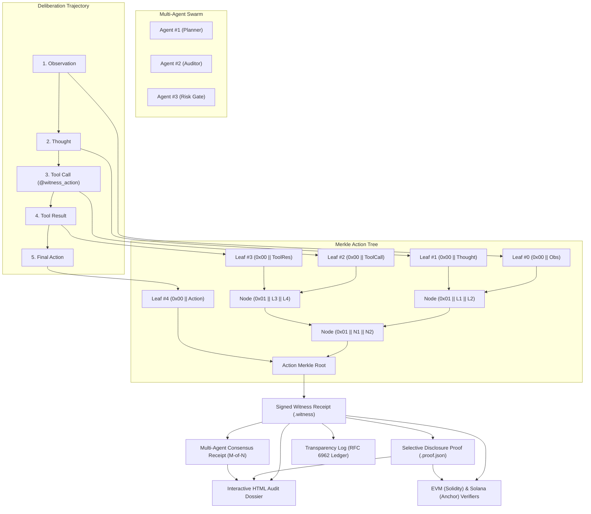

# agent-witness

> **Cryptographic action attestation, selective disclosure, transparency logs & Merkle audit receipts for autonomous AI agents.**

[](https://github.com/devsoniclk/agent-witness/actions)
[](LICENSE)
[](https://pypi.org/project/agent-witness/)

---

## 1. Problem Statement
As autonomous AI agents execute financial transactions, trade assets, call internal APIs, and deploy smart contracts, a fundamental trust gap emerges: **How can an external API gateway, DAO treasury, smart contract, or compliance auditor prove that an action was genuinely generated by an authorized agent model following an approved system prompt and real observations, rather than a forged API call, unauthorized prompt injection, or compromised key?**

## 2. Why Existing Solutions Are Insufficient
- **Standard Audit Logs (ELK / JSONL)**: Easily modified retroactively, lack non-repudiation, and cannot be cryptographically verified on-chain.
- **ZK / TEE Inference Proofs**: High computational cost, vendor hardware lock-in (Intel SGX / Nvidia H100 TEE), and prohibitive multi-second latency for real-time agent tool loops.
- **On-Chain Agent Registries (`sigil`, ERC-8004)**: Register agent identities and addresses, but do not provide verifiable proof of individual deliberation trajectories or tool result sequences.

## 3. What `agent-witness` Does Differently
`agent-witness` is an enterprise-grade, **hardware-independent, zero-dependency cryptographic attestation engine**:
- **RFC 6962 Merkle Action Trees**: Incrementally hashes every observation, thought, tool invocation, and decision into a domain-separated Merkle tree.
- **Cryptographic Action Receipts (`.witness`)**: Produces compact, tamper-evident cryptographic receipts binding model metadata, prompt hash, and Merkle root.
- **Selective Disclosure Proof Bundles**: Prove that a critical safety check or specific trade tool call occurred without revealing confidential prompts or private reasoning tokens.
- **Tamper-Evident Chronological Transparency Logs**: Append-only cryptographic ledger maintaining Signed Tree Heads (STH), producing verifiable audit inclusion proofs and historical consistency proofs.
- **Multi-Agent Threshold Consensus**: Cryptographic quorum attestation where multiple collaborative agents (e.g. planner, auditor, risk gate) sign off on shared action trajectories.
- **Model Context Protocol (MCP) Server**: Standard JSON-RPC 2.0 stdio server providing 10 cryptographic tools to autonomous coding agents (Claude Code, OpenBot, Cursor, Cline).
- **Forensic Multi-Layer Trajectory Auditor**: End-to-end verification engine checking step sequence continuity, timestamp monotonicity, canonical leaf hashes, Merkle root validity, signatures, log inclusion, and consensus quorums.
- **Interactive Dark-Mode HTML Audit Dossier**: Offline, dependency-free visual reports featuring responsive SVG Merkle tree diagrams, expandable step timelines, and verification badges.
- **Universal Tool Middleware**: Intercept and attest synchronous and asynchronous agent functions with `@witness_action`.
- **EIP-712 Structured Data Standards**: Zero-dependency pure Python Keccak-256 and EIP-712 typed struct hashing for instant EVM smart contract verification (`ecrecover`).
- **Cross-Chain Verifiers**: Production-ready on-chain verification programs for both **Ethereum (Solidity)** and **Solana (Anchor)**.
- **Sub-Millisecond Verification**: Off-chain verification in `<0.1ms`; on-chain EVM verification in `<28,000 gas`.

---

## 4. Architecture



---

## 5. Installation

```bash
pip install agent-witness
```

Or install from source with dev extras:
```bash
git clone https://github.com/devsoniclk/agent-witness.git
cd agent-witness
pip install -e .[dev]
```

---

## 6. Quick-Start Guide

### 1. Tool Middleware (`@witness_action`)
Automatically record and attest sync and `async` agent tool executions:

```python
import asyncio
from agent_witness import WitnessEngine, witness_action, witness_scope

engine = WitnessEngine(
    agent_id="rebalance-agent-01",
    model_id="claude-3-7-sonnet",
    system_prompt="Autonomous DeFi rebalance bot",
)

# Universal sync/async tool decorator
@witness_action(engine)
async def execute_swap(pool: str, amount_in: float) -> str:
    # Simulated execution
    return f"tx_hash_0x123_swapped_{amount_in}"

async def main():
    with witness_scope(engine, scope_name="market_check"):
        await execute_swap("SOL-USDC", 50.0)

    receipt = engine.finalize_receipt()
    print("Attested Merkle Root:", receipt.merkle_root)

asyncio.run(main())
```

### 2. Selective Disclosure Proof Export
Disclose only the critical action step without exposing private system prompts or other reasoning steps:

```python
from agent_witness import export_proof_bundle, verify_proof_bundle

# Export proof for step #1
proof_bundle = export_proof_bundle(receipt, step_index=1)

# Third-party verifier validates the proof standalone
is_valid, report = verify_proof_bundle(proof_bundle.to_dict())
assert is_valid
print(report)
# Output: Verified: Step #1 is cryptographically bound to Merkle root ...
```

### 3. Chronological Transparency Log
Append receipts to a tamper-evident audit ledger and generate consistency proofs:

```python
from agent_witness import TransparencyLog

log = TransparencyLog(log_dir=".witness_log")
rec = log.append_receipt(receipt)

# Generate Signed Tree Head checkpoint
checkpoint = log.create_checkpoint()

# Generate audit inclusion proof for receipt #0
proof = log.get_inclusion_proof(log_index=0)
assert TransparencyLog.verify_inclusion_proof(proof)

# Verify append-only consistency between tree sizes
consistency = log.get_consistency_proof(old_size=1, new_size=log.tree_size)
is_valid, msg = TransparencyLog.verify_consistency_proof(consistency)
assert is_valid
```

### 4. Multi-Agent Threshold Consensus
Coordinate multi-agent quorum attestation for sensitive decisions:

```python
from agent_witness import MultiAgentConsensusEngine, verify_consensus_receipt, AgentSigner

signer_auditor = AgentSigner()
signer_risk = AgentSigner()

# Require 2-of-2 consensus
consensus_engine = MultiAgentConsensusEngine.from_receipt(receipt, threshold=2)
consensus_engine.add_attestation(signer_auditor, "sec-audit", "o3-mini", "AUDITOR", "APPROVE")
consensus_engine.add_attestation(signer_risk, "risk-gate", "gpt-4o", "RISK_GATE", "APPROVE")

consensus_receipt = consensus_engine.finalize()
is_valid, report = verify_consensus_receipt(consensus_receipt)
assert is_valid
print(f"Consensus reached: {report['approved_count']}/{report['threshold']}")
```

### 5. Interactive Dark-Mode HTML Audit Dossier
Render a standalone, zero-dependency HTML diagnostic dossier:

```python
from agent_witness import render_html_report

# Save interactive visual report to disk
render_html_report(receipt, output_file="audit_dossier.html")
```

---

## 7. On-Chain Verifiers

### Ethereum / EVM (`contracts/AgentWitnessVerifier.sol`)
Deploy the zero-dependency Solidity verifier on any EVM network:

```solidity
// Verify single-step inclusion proof in <28k gas:
require(
    verifier.verifyProof(stepLeafHash, auditPath, receiptMerkleRoot),
    "Invalid agent deliberation proof"
);

// Verify signed EIP-712 receipt via ecrecover:
require(
    verifier.verifyReceiptSignature(receiptData, v, r, s, expectedAgentAddress),
    "Unauthorized agent signer"
);
```

### Solana Anchor (`contracts/solana/programs/agent_witness/src/lib.rs`)
Verify agent deliberation proofs on Solana using Anchor:

```rust
use agent_witness::verify_merkle_membership;

let is_valid = verify_merkle_membership(&leaf_hash, &audit_path, &expected_root);
require!(is_valid, WitnessError::InvalidProof);
```

---

## 8. CLI Usage

```bash
# 1. Run full forensic multi-layer audit (checks continuity, timestamps, leaf hashes, root, sigs)
agent-witness audit trade_receipt.witness --html dossier.html

# 2. Inspect a .witness cryptographic receipt (optionally render HTML dossier)
agent-witness inspect trade_receipt.witness --html dossier.html

# 3. Verify Merkle root integrity
agent-witness verify trade_receipt.witness

# 4. Launch Model Context Protocol (MCP) stdio server for AI agents
agent-witness mcp --log-dir .witness_log

# 5. Export selective disclosure proof for step #2
agent-witness export-proof trade_receipt.witness --step 2 --output step2_proof.json

# 6. Verify standalone selective disclosure proof
agent-witness verify-proof step2_proof.json

# 7. Append receipt to transparency log
agent-witness log append trade_receipt.witness --log-dir .witness_log

# 8. Check transparency log status & Signed Tree Head
agent-witness log status --log-dir .witness_log

# 9. Generate Signed Tree Head checkpoint
agent-witness log checkpoint --log-dir .witness_log

# 10. Verify multi-agent consensus receipt
agent-witness consensus verify consensus.json
```

---

## 9. Model Context Protocol (MCP) Configuration

Configure `agent-witness` as an MCP server for **Claude Code**, **Cursor**, **OpenBot**, or **Cline**:

```json
{
  "mcpServers": {
    "agent-witness": {
      "command": "agent-witness",
      "args": ["mcp", "--log-dir", ".witness_log"]
    }
  }
}
```

### Provided MCP Tools

| Tool | Description |
| :--- | :--- |
| `witness_record_action` | Cryptographically record deliberation or tool action step (`observation`, `thought`, `tool_call`, `tool_result`, `decision`). |
| `witness_finalize_receipt` | Finalize session into an RFC 6962 Merkle tree with signed root and return an immutable `WitnessReceipt`. |
| `witness_audit_trajectory` | Run multi-layer forensic audit (step continuity, timestamps, leaf hashes, Merkle root, signatures, consensus). |
| `witness_export_proof` | Generate an RFC 6962 selective disclosure proof bundle for a specific step index. |
| `witness_verify_proof` | Verify a selective disclosure proof bundle against its Merkle root without disclosing other steps. |
| `witness_log_append` | Append a receipt to the persistent append-only Chronological Transparency Log. |
| `witness_log_checkpoint` | Create a signed Signed Tree Head (STH) checkpoint of the transparency log. |
| `witness_log_verify_consistency` | Verify append-only consistency between two log tree sizes. |
| `witness_attest_consensus` | Cast an agent attestation vote towards M-of-N threshold consensus. |
| `witness_generate_dossier` | Generate a standalone dark-mode HTML audit dossier with embedded SVG Merkle tree. |

---

## 10. Benchmarks

Measured on Apple Silicon (M5 Air):

| Operation | Latency | Memory Overhead |
| :--- | :--- | :--- |
| **Merkle Tree Build (10 steps)** | `0.11 ms` | `< 0.5 MB` |
| **Merkle Inclusion Proof Generation** | `0.04 ms` | `< 0.2 MB` |
| **Standalone Proof Verification** | `0.02 ms` | `< 0.1 MB` |
| **Forensic Trajectory Audit (7 checks)** | `0.15 ms` | `< 0.4 MB` |
| **Transparency Log Append & Hash** | `0.06 ms` | `< 0.3 MB` |
| **Multi-Agent Threshold Verification (3 signers)** | `0.18 ms` | `< 0.4 MB` |
| **HTML Dossier Generation** | `0.85 ms` | `< 1.0 MB` |
| **Pure Python Keccak-256 (32B)** | `0.03 ms` | `< 0.1 MB` |
| **Solidity Gas Cost (Depth 4)** | `~26,400 gas` | — |

---

## 11. Security Considerations
- Uses RFC 6962 domain separation prefixes (`0x00` leaves, `0x01` internal nodes) to prevent second-preimage attacks.
- Deliberation steps use canonical deterministic byte encodings (`index:type:content:metadata:timestamp`).
- Transparency log enforces tamper-evident append-only sequence checks and Signed Tree Heads.
- All cryptographic primitives (SHA-256, Keccak-256, HMAC-SHA256, EIP-712) implemented with zero external runtime dependencies.

---

## 12. Roadmap
- [x] RFC 6962 incremental Merkle Tree.
- [x] Cryptographic Witness Receipt builder & verifier.
- [x] Solidity `AgentWitnessVerifier.sol` contract with EIP-712 support.
- [x] Solana Anchor on-chain verification program (`contracts/solana`).
- [x] EIP-712 structured data signing standard & pure Python Keccak-256.
- [x] Selective disclosure proof export & standalone verification.
- [x] Universal sync/async tool middleware (`@witness_action`).
- [x] Tamper-evident chronological Transparency Logs (`TransparencyLog`).
- [x] Multi-agent threshold consensus engine (`MultiAgentConsensusEngine`).
- [x] Interactive dark-mode HTML audit dossier visualizer.
- [x] Standard Model Context Protocol (MCP) stdio server (`agent-witness mcp`).
- [x] Multi-layer forensic trajectory audit engine (`verify_trajectory_integrity`, `agent-witness audit`).
- [ ] ZK-SNARK circuit for zero-knowledge agent step proofs.

---

## 13. Contributing
See [CONTRIBUTING.md](CONTRIBUTING.md) for contribution guidelines.

---

## 14. License
Distributed under the [Apache-2.0 License](LICENSE). Copyright 2026 Lakshitha Dananjaya (`devsoniclk`).
