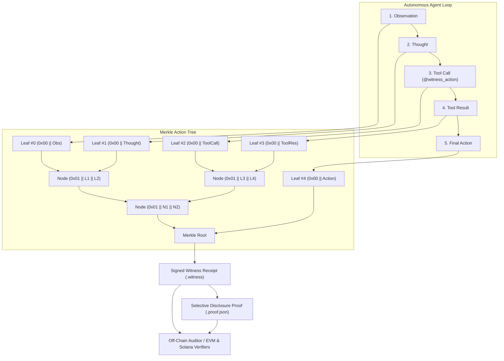

# agent-witness

> **Cryptographic action attestation, selective disclosure & Merkle audit receipts for autonomous AI agents.**

[](https://github.com/devsoniclk/agent-witness/actions)
[](LICENSE)
[](https://pypi.org/project/agent-witness/)

---

## 1. Problem Statement
As autonomous AI agents execute financial transactions, trade assets, call internal APIs, and deploy smart contracts, a fundamental trust gap emerges: **How can an external API gateway, DAO treasury, smart contract, or compliance auditor prove that an action was genuinely generated by an authorized agent model following an approved system prompt and real observations, rather than a forged API call, unauthorized prompt injection, or compromised key?**

## 2. Why Existing Solutions Are Insufficient
- **Standard Audit Logs (ELK / JSONL)**: Easily modified, lack non-repudiation, and cannot be cryptographically verified on-chain.
- **ZK / TEE Inference Proofs**: High computational cost, vendor hardware lock-in (Intel SGX / Nvidia H100 TEE), and prohibitive multi-second latency for real-time agent tool loops.
- **On-Chain Agent Registries (`sigil`, ERC-8004)**: Register agent identities and addresses, but do not provide verifiable proof of individual deliberation trajectories or tool result sequences.

## 3. What `agent-witness` Does Differently
`agent-witness` is a **hardware-independent, zero-dependency cryptographic attestation engine**:
- **RFC 6962 Merkle Action Trees**: Incrementally hashes every observation, thought, tool invocation, and decision into a domain-separated Merkle tree.
- **Cryptographic Action Receipts (`.witness`)**: Produces compact, tamper-evident cryptographic receipts binding model metadata, prompt hash, and Merkle root.
- **Selective Disclosure Proof Bundles**: Prove that a critical safety check or specific trade tool call occurred without revealing confidential prompts or private reasoning tokens.
- **Universal Tool Middleware**: Intercept and attest synchronous and asynchronous agent functions with `@witness_action`.
- **EIP-712 Structured Data Standards**: Zero-dependency pure Python Keccak-256 and EIP-712 typed struct hashing for instant EVM smart contract verification (`ecrecover`).
- **Cross-Chain Verifiers**: Production-ready on-chain verification programs for both **Ethereum (Solidity)** and **Solana (Anchor)**.
- **Sub-Millisecond Verification**: Off-chain verification in `<0.1ms`; on-chain EVM verification in `<28,000 gas`.

---

## 4. Architecture



---

## 5. Installation

```bash
pip install agent-witness
```

Or install from source with dev extras:
```bash
git clone https://github.com/devsoniclk/agent-witness.git
cd agent-witness
pip install -e .[dev]
```

---

## 6. Quick-Start Guide

### 1. Tool Middleware (`@witness_action`)
Automatically record and attest sync and `async` agent tool executions:

```python
import asyncio
from agent_witness import WitnessEngine, witness_action, witness_scope

engine = WitnessEngine(
    agent_id="rebalance-agent-01",
    model_id="claude-3-7-sonnet",
    system_prompt="Autonomous DeFi rebalance bot",
)

# Universal sync/async tool decorator
@witness_action(engine)
async def execute_swap(pool: str, amount_in: float) -> str:
    # Simulated execution
    return f"tx_hash_0x123_swapped_{amount_in}"

async def main():
    with witness_scope(engine, scope_name="market_check"):
        await execute_swap("SOL-USDC", 50.0)

    receipt = engine.finalize_receipt()
    print("Attested Merkle Root:", receipt.merkle_root)

asyncio.run(main())
```

### 2. Selective Disclosure Proof Export
Disclose only the critical action step without exposing private system prompts or other reasoning steps:

```python
from agent_witness import export_proof_bundle, verify_proof_bundle

# Export proof for step #1
proof_bundle = export_proof_bundle(receipt, step_index=1)

# Third-party or smart contract verifier validates the proof standalone
is_valid, report = verify_proof_bundle(proof_bundle.to_dict())
assert is_valid
print(report)
# Output: Verified: Step #1 is cryptographically bound to Merkle root ...
```

### 3. EIP-712 EVM Typed Structured Data
Hash receipts according to EIP-712 for Ethereum / EVM on-chain verification:

```python
from agent_witness import EIP712Domain, compute_eip712_digest

domain = EIP712Domain(
    name="AgentWitness",
    version="1",
    chain_id=1,
    verifying_contract="0x1234567890123456789012345678901234567890",
)

digest = compute_eip712_digest(receipt, domain)
print("EIP-712 Digest for ecrecover:", "0x" + digest.hex())
```

---

## 7. On-Chain Verifiers

### Ethereum / EVM (`contracts/AgentWitnessVerifier.sol`)
Deploy the zero-dependency Solidity verifier on any EVM network:

```solidity
// Verify single-step inclusion proof in <28k gas:
require(
    verifier.verifyProof(stepLeafHash, auditPath, receiptMerkleRoot),
    "Invalid agent deliberation proof"
);

// Verify signed EIP-712 receipt via ecrecover:
require(
    verifier.verifyReceiptSignature(receiptData, v, r, s, expectedAgentAddress),
    "Unauthorized agent signer"
);
```

### Solana Anchor (`contracts/solana/programs/agent_witness/src/lib.rs`)
Verify agent deliberation proofs on Solana using Anchor:

```rust
use agent_witness::verify_merkle_membership;

let is_valid = verify_merkle_membership(&leaf_hash, &audit_path, &expected_root);
require!(is_valid, WitnessError::InvalidProof);
```

---

## 8. CLI Usage

```bash
# 1. Inspect a .witness cryptographic receipt
agent-witness inspect trade_receipt.witness

# 2. Verify Merkle root integrity
agent-witness verify trade_receipt.witness

# 3. Export selective disclosure proof for step #2
agent-witness export-proof trade_receipt.witness --step 2 --output step2_proof.json

# 4. Verify standalone selective disclosure proof
agent-witness verify-proof step2_proof.json
```

---

## 9. Benchmarks

Measured on Apple Silicon (M5 Air):

| Operation | Latency | Memory Overhead |
| :--- | :--- | :--- |
| **Merkle Tree Build (10 steps)** | `0.11 ms` | `< 0.5 MB` |
| **Merkle Inclusion Proof Generation** | `0.04 ms` | `< 0.2 MB` |
| **Standalone Proof Verification** | `0.02 ms` | `< 0.1 MB` |
| **Pure Python Keccak-256 (32B)** | `0.03 ms` | `< 0.1 MB` |
| **Solidity Gas Cost (Depth 4)** | `~26,400 gas` | — |

---

## 10. Security Considerations
- Uses RFC 6962 domain separation prefixes (`0x00` leaves, `0x01` internal nodes) to prevent second-preimage attacks.
- Deliberation steps use canonical deterministic byte encodings (`index:type:content:metadata:timestamp`).
- All cryptographic primitives (SHA-256, Keccak-256, HMAC-SHA256, EIP-712) implemented with zero external runtime dependencies.

---

## 11. Roadmap
- [x] RFC 6962 incremental Merkle Tree.
- [x] Cryptographic Witness Receipt builder & verifier.
- [x] Solidity `AgentWitnessVerifier.sol` contract with EIP-712 support.
- [x] Solana Anchor on-chain verification program (`contracts/solana`).
- [x] EIP-712 structured data signing standard & pure Python Keccak-256.
- [x] Selective disclosure proof export & standalone verification.
- [x] Universal sync/async tool middleware (`@witness_action`).
- [ ] ZK-SNARK circuit for private agent step proofs.

---

## 12. Contributing
See [CONTRIBUTING.md](CONTRIBUTING.md) for contribution guidelines.

---

## 13. License
Distributed under the [Apache-2.0 License](LICENSE). Copyright 2026 Lakshitha Dananjaya (`devsoniclk`).
